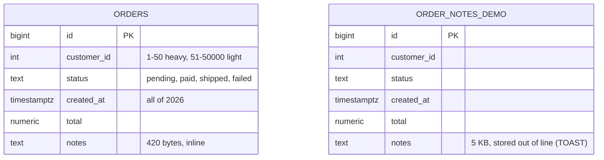
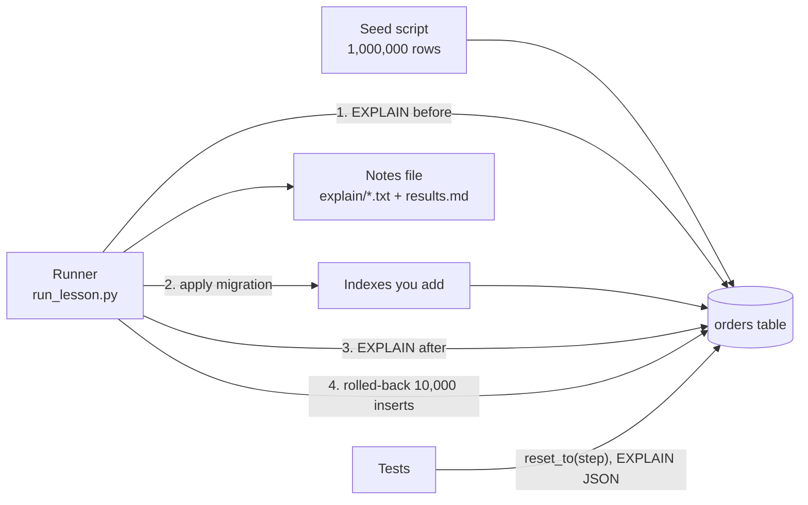

# Architecture: three slow queries

One PostgreSQL 18 database, one table that matters, and a handful of scripts and tests that hold the evidence. Component names follow the lesson's diagram ("The project: one table, three slow queries").

## Components

| Component | What it is | What it owns |
|---|---|---|
| **Seed script** | `sql/001_schema.sql` + `sql/002_seed.sql` | Creates `orders` and loads 1,000,000 skewed rows with `generate_series`; runs `VACUUM (ANALYZE)` so statistics and the visibility map are fresh. Owns the shape of the data: nothing else inserts rows except the rolled-back write-cost batches. |
| **orders table** | PostgreSQL table `orders` (plus `order_notes_demo`) | The only data. Primary key only, until a migration adds more. |
| **Indexes you add** | `sql/migrations/001` to `004` | One index per change, each with a comment saying which plan justified it. Applied in order; `004` drops one. |
| **Day query** | `sql/explain/q1_day_*.sql` | The slow form (`date(created_at) = ...`) and the fixed range form. |
| **Latest orders** | `sql/explain/q2_latest_*` | One customer's ten newest orders, for a heavy customer and a small one. |
| **Wide listing** | `sql/explain/q3_*` | `SELECT *` against five named columns against a covering index, plus the TOAST demo. |
| **Notes file** | `sql/explain/results.md` and the `.txt` plans | The lesson's "keep in the notes file": every plan before and after, timing, pages read. Generated by `scripts/run_lesson.py`, committed. |
| **Runner** | `scripts/run_lesson.py`, `scripts/lab.py` | Replays the lesson in order, captures plans, measures write cost. `lab.py` is the shared helper (connect, split and run SQL files, parse plans). |
| **Tests** | `tests/test_lesson.py` | One test per "Done when" line. Each test puts the table in the state it needs (`reset_to`) so tests do not depend on each other. |

## Schema



There is no `customers` table: the lesson only needs `customer_id` as a skewed number. The two tables are unrelated; `order_notes_demo` exists only to show what an out-of-line column costs.

Indexes after all migrations: `orders_pkey (id)`, `idx_orders_created_at (created_at)`, `idx_orders_listing (customer_id, created_at DESC) INCLUDE (id, status, total)`.

## Data flow of one run (`make run`)



1. `make db` has already created and seeded the table. The runner drops any lesson index (`reset_to(0)`) so every run starts from the primary key alone.
2. For each query it executes the `.sql` file twice and keeps the second plan, so a cold cache does not distort the first number. The plan text goes to the `.txt` next to it.
3. It times 10,000 inserts with no new index, then applies migration `001`, captures `q1_day_after`, times the inserts again, and so on through `004`. Each insert batch runs under `EXPLAIN (ANALYZE, BUFFERS, WAL)` and is rolled back, so the table stays at 1,000,000 rows. The runner asserts that.
4. It writes `results.md`: before and after milliseconds and pages for each query, the write cost per index set, and the index sizes.
5. `make test` repeats the key measurements with `EXPLAIN (FORMAT JSON)` and asserts on the plan tree (node types, index names, buffers), not on prose.

## Reading the day query's plan, line by line

From `sql/explain/q1_day_before.txt`:

```text
Seq Scan on orders  (cost=0.00..78125.01 rows=5000 width=456) (actual time=1.158..384.276 rows=2748.00 loops=1)
  Filter: (date(created_at) = '2026-03-14'::date)
  Rows Removed by Filter: 997252
  Buffers: shared hit=47646 read=15479 written=158
```

- `Seq Scan`: no index can answer the question, so every page of the table is read: 63,125 pages (`hit` + `read`), 493 MB.
- `Filter` with `Rows Removed by Filter: 997252`: each of the million rows was read, `date()` was computed, and 997,252 failed the test. This is where the time went.
- `rows=5000` against `rows=2748.00`: the estimate is a guess. Through `date()` the planner cannot use the statistics of `created_at`, so it applies a built-in default fraction of the table. The true count is 2,748, about one day's share of a year (1,000,000 / 365 = 2,740).
- `Buffers ... read=15479`: part of the table came from disk (or the operating system cache) rather than PostgreSQL's own buffers; `written=158` is the scan evicting dirty pages. Both vanish on a warm second run, which is why the runner keeps the second run.

After the range rewrite and `idx_orders_created_at`, the plan becomes a `Bitmap Index Scan` on the index (11 pages) feeding a `Bitmap Heap Scan` (2,702 heap pages). It is a bitmap scan, not a plain `Index Scan`, because `created_at` has no relation to the physical row order here (the seed assigns timestamps at random), so 2,748 rows live on 2,702 different pages and visiting them in page order wins.

## Decisions and trade-offs

- **`created_at` index, a plain B-tree.** The only access pattern is a range on one column. The range is half-open (`>= start AND < next day`) so there is no off-by-one at midnight and no `BETWEEN` that includes the next day's first instant.
- **`(customer_id, created_at DESC)`: equality column first, sort column second.** The index stores one customer's rows together and newest first, which is exactly the order `ORDER BY created_at DESC LIMIT 10` wants. `(created_at, customer_id)` would put the whole year in time order and cannot seek to one customer. The `DESC` is not required (an ascending index can be scanned backward), but it makes the intent readable and matters once there is a second sort column.
- **Covering index with `INCLUDE`, not extra key columns.** `INCLUDE (id, status, total)` stores those columns in the leaf pages without making them part of the ordering key, so the index keeps its sort order and uniqueness semantics. The cost is size: 60 MB against 30 MB for the narrow index.
- **Why 506 pages for 1,010 rows on an `Index Only Scan`.** The index itself is only a handful of pages. The rest are visibility-map lookups: each row's heap page must be checked as all-visible, and the table's 63,125 heap pages need two 8 KB visibility-map pages, so a customer's rows (spread over 1,000 heap pages) keep switching between them and each switch is counted as a buffer access. Measured: the same query on a copy of the table cut to 28,160 heap pages (one map page) read 7 pages for 489 rows. So the count is correct but partly an accounting artifact; heap fetches, the expensive part, are zero.
- **`VACUUM` after the covering index (migration `003`).** An index-only scan is only index-only for pages the visibility map marks all-visible. Without the `VACUUM`, `Heap Fetches` would not be 0. On a table that takes writes all day, expect some heap fetches to remain.
- **Dropping the narrow index (migration `004`).** `idx_orders_listing` starts with the same two columns, so it also serves query 2; two indexes with the same prefix is write cost with no read benefit. The trade-off is that the one remaining index is about twice the size of the narrow one, so every plan on it touches slightly more index pages.
- **Statistics.** `VACUUM (ANALYZE)` right after the load, and `ANALYZE` after each `reset_to`. Plans read against stale statistics are misleading evidence, which is why the first test asserts fresh statistics before anything else.
- **Planner settings the lesson touches.** Only `max_parallel_workers_per_gather = 0` (server-wide in the compose file, and per connection in `lab.connect()` so CI behaves the same). `track_io_timing = on` adds the `I/O Timings` lines to plans.
- **Seed determinism.** `setseed(0.42)` makes the "random" data repeat, so customer 31337 always has seven orders and the day query always finds 2,748 rows. Tests rely on the shape (skew, magnitudes), not on exact counts, except where noted.

## Failure modes the lesson teaches, and how to reproduce each

All of these run in `make psql` after `make db`; the first line makes sure no lesson index exists.

| Failure | Reproduce | What you see |
|---|---|---|
| **Sequential scan from a non-sargable predicate** | `DROP INDEX IF EXISTS idx_orders_created_at; EXPLAIN (ANALYZE, BUFFERS) SELECT * FROM orders WHERE date(created_at) = '2026-03-14';` | `Seq Scan`, 997,252 rows removed by filter. Create the index and keep the `date()` form: the plan is still a `Seq Scan`, because the index is on the raw value. |
| **Sort of a whole customer's rows** | `EXPLAIN (ANALYZE) SELECT * FROM orders WHERE customer_id = 7 ORDER BY created_at DESC LIMIT 10;` with only the primary key | `Seq Scan` feeding `Sort Method: top-N heapsort`; 63,125 pages for ten rows. An index on `created_at` alone does not fix it: the planner walks the time index backward and filters by customer (80 ms for a heavy customer in a trial run; a customer with few orders makes it walk much further before it finds ten). |
| **Fetching what you do not show** | Run `sql/explain/q3_toast_wide.sql` then `q3_toast_narrow.sql` | The wide query reads 10,832 pages (the table's 207 plus the TOAST table, shown under `Serialization:`), the narrow one 207. |
| **A covering index that is not index-only** | Create `idx_orders_listing`, then `UPDATE orders SET total = total WHERE customer_id = 7;` and run `q3_listing_after.sql` before any `VACUUM` | The plan is still an `Index Only Scan`, but `Heap Fetches` jumps from 0 to 2,020 and the time from 0.26 ms to 134 ms (trial run): the updated pages are not all-visible until `VACUUM orders` runs, and after it `Heap Fetches` is 0 again. |
| **The index tax** | Read the write-cost table in `sql/explain/results.md`, or run `make run` | Each index adds about 10,000 WAL records and 30,000 page touches per 10,000 inserts. |

The lesson's other classic failure modes (lock wait, bloat) belong to the next two projects; this one does not produce them. The write-cost batches are rolled back, which leaves dead row versions behind that `VACUUM orders` in the runner clears.

## Limits against production

- **A single user.** There is no concurrency, so no lock waits and no cache contention. The measured times are warm-cache times on a shared laptop.
- **Static data.** The table is loaded once and never updated, so the visibility map stays clean and index-only scans look better than they would on a busy table.
- **Uniform row layout.** `notes` is identical in every row; real text varies, compresses differently and crosses the TOAST threshold unpredictably.
- **No `customers` table, no foreign keys.** Real orders have both, and a foreign key adds a check on every insert.
- **Indexes were built on a loaded table.** Production indexes are usually added concurrently on a table in use (project 3 of this track).
- **Rolled-back inserts are not committed inserts.** They exercise the same heap and index code but skip the commit flush, so absolute write times understate a real insert path.

## How to extend it

- **MySQL.** Port `sql/001_schema.sql` and `sql/002_seed.sql` (a recursive CTE or a numbers table replaces `generate_series`, `ARRAY[...]` becomes `ELT()`), add a second compose service, and compare `EXPLAIN ANALYZE` output with the PostgreSQL plans in `sql/explain/`.
- **Partial index for rare statuses.** Change the seed so `failed` is about 0.1% of rows, add `CREATE INDEX ... (customer_id) WHERE status = 'failed'`, and test with a query whose predicate matches it and one that does not.
- **Type mismatch.** Add an explicit cast on the column (`WHERE customer_id::text = '7'`) as an `explain/q4_*.sql` and show the index stops being used.
- **Another query.** Add `sql/explain/q4_before.sql`, list its name in `scripts/run_lesson.py`, and add a test next to the others.
